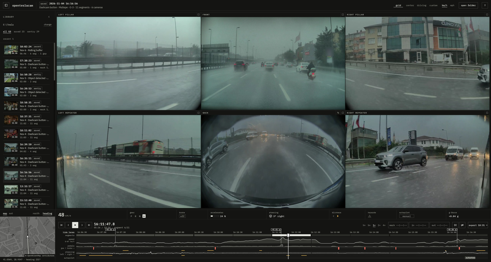
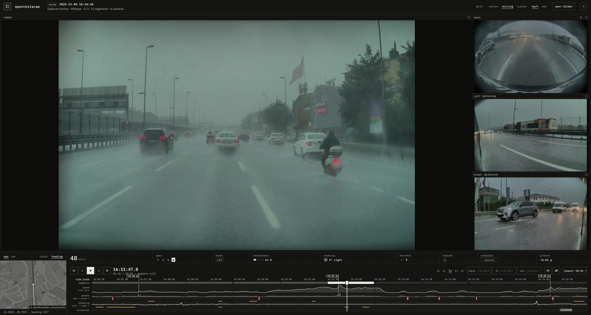

<p align="center"></p>

<h1 align="center">OpenTeslaCam</h1>

A Tesla dashcam viewer for Windows. It plays all six cameras in sync on one timeline, next to the data the car
writes into the video: speed, gear, pedals, steering, blinkers, Autopilot state and GPS.



**[Download the latest setup](https://github.com/MOmerTepe/openteslacam/releases/latest)** (Windows 10 or 11).

I built this for my own car and I'm putting it out for anyone who needs it. No guarantees. Use it, fork it,
fix it.

## Built with AI

The code in this repo is written with [Claude Code](https://claude.com/claude-code), Anthropic's coding
assistant. I decide what the app does and how it behaves, and I check it on my own car's footage. That is one
HW4 car, so some things are only known to be right there; the release notes say so where it matters. Read the
code before you trust it with footage you can't replace. `CLAUDE.md` is the brief the assistant works from, and
it doubles as the architecture notes.

## What it does

- Plays six cameras on one clock, in the Grid, Center or Driving layout or one you arrange yourself.
- Shows the vehicle data in a strip below the video and as lanes on the timeline, and the car's position on a
  map. Nothing is drawn over the footage.
- Exports the part between In and Out: a lossless MP4 per camera, or one composited MP4, plus the vehicle data
  as CSV.
- Copies a TeslaCam drive into a folder on your PC and checks every copy before it counts.
- Lets you mark the moment that matters, trim an event to it, drop cameras you don't need, and archive or
  delete events. Removed files go to the Recycle Bin.
- Offers a newer version when it starts and installs it itself.

## Encrypted clips

Newer Tesla firmware encrypts dashcam footage by default (an `EncryptedClips` folder). **This viewer can't
decrypt or play those clips.** They aren't real MP4 files, and only the car that recorded them, or
`dashcam.tesla.com` signed in to the linked account, can decrypt them. They show up in the library with a
`locked` badge.

To use your footage here, turn encryption off in the car: **Controls → Safety → Encrypt Dashcam Recordings**.
Clips recorded after that are normal MP4s. Clips already encrypted stay unreadable.

## Install

Get `OpenTeslaCam-Setup-x.y.z.exe` from the
[releases page](https://github.com/MOmerTepe/openteslacam/releases/latest) and run it. It installs for your
user only and doesn't need administrator rights. Windows SmartScreen may warn you, because the installer isn't
code-signed.

From 2.2 on the app updates itself. Versions 2.0.1 and 2.1.0 show `update to …` in the top bar, which opens the
download page: close OpenTeslaCam and run the new setup. It finds the installed app and updates it where it is.
Settings, saved layouts and shortcuts stay. Version 2.0.0 has no such notice, so update it from the releases
page. Coming from 1.x, uninstall 1.x first.

Setup can also fetch [Tesla's dashcam tools](https://github.com/teslamotors/dashcam) into
`<install folder>\vendor-dev\dashcam`, and Git if that needs it. This is optional. The app doesn't use them to
play clips; they're for reference and for testing the parser.

To uninstall, use Windows' installed apps. It removes only what setup installed, and leaves your clips,
settings, saved layouts and Git.

Unattended install: `OpenTeslaCam-Setup-x.y.z.exe --silent --dir <folder> [--desktop] [--tesla]`. Without
`--dir`, it updates the installed app where it is. Unattended uninstall: `uninstall.exe --uninstall --silent`.

## Using it

Choose `open folder`, or drop a folder on the window, and pick your `TeslaCam` folder or a single clip folder.
The last folder reopens next time.

```
TeslaCam/
├── SavedClips/
│   └── 2024-01-15_12-30-00/
│       ├── 2024-01-15_12-30-00-front.mp4
│       ├── ...-back.mp4  ...-left_repeater.mp4  ...-right_repeater.mp4
│       ├── ...-left_pillar.mp4  ...-right_pillar.mp4
│       ├── event.json
│       └── thumb.png
├── SentryClips/
└── RecentClips/
```



### Layouts

- **Grid:** all six cameras at equal size.
- **Center:** front large in the middle with back below it, and pillar and repeater on each side.
- **Driving:** front as large as possible, with back and both repeaters on the right.
- **Custom:** drag and resize cameras on a snapping grid, hide the ones you don't need, and save layouts by name.

Double-click a camera to focus it. The library panel closes to give the cameras its width.

### Shortcuts

| Key | Action |
|---|---|
| `Space` | Play / pause |
| `←` / `→` | Seek ±5 s |
| `Shift + ←` / `→` | Seek ±30 s |
| `,` / `.` | Step one frame (while paused) |
| `Page Up` / `Page Down`, or `[` / `]` | Previous / next segment |
| `Home` / `End` | Jump to start / end |
| `I` / `O` | Set In / Out |
| `M` | Mark the moment on screen, or the In–Out range |
| `Esc` | Close a panel, or leave focus |
| `?` | Show all shortcuts |

### Command line

| Flag | What it does |
|---|---|
| `--version` | Print the version |
| `--dump-sei <clip.mp4>` | Print the clip's vehicle data as CSV |
| `--scan <folder>` | Print what the library scan finds |
| `--bench-decode <folder or clips>` | Measure decode speed on real clips, up to 6 at once |
| `--bench-synthetic` | The same on generated clips (indicative only) |

## Requirements

| | |
|---|---|
| **Operating system** | Windows 10 or 11, 64-bit |
| **Graphics** | A driver with DirectX 12, Vulkan or OpenGL ES support |
| **Footage** | Unencrypted TeslaCam clips (see above) |
| **Vehicle data and map** | Clips from firmware 2025.44.25 or later on HW3 or newer. Older clips still play, and parked cars may record no vehicle data |
| **Internet** | Only for map tiles and the check for a newer version. Everything else works offline |

Nothing else needs installing. The video decoder and vehicle-data parser are built in, and there's no VC++
Redistributable, FFmpeg, Python or Node involved.

Video is decoded on the GPU through Windows' own H.264 decoder. Without a capable GPU it uses that decoder on the
CPU, and on editions without it (Windows N and some Server editions) a built-in software decoder. HW4 clips have a
much larger front camera: at 4× speed it keeps every frame while the other cameras show keyframes only, and on a
slower machine it may skip between keyframes at 2× too. To measure your machine, run
`openteslacam --bench-decode <folder>` on some clips. If video looks wrong, set the environment variable
`OPENTESLACAM_DECODER` to `software` to stay off the GPU, or `openh264` to use the built-in decoder.

A composited export encodes on the graphics card's H.264 encoder (NVIDIA NVENC, AMD or Intel through Windows)
when the machine has one, which is about twice as fast at 4K. The export dialog then shows an **encoder** choice:
pick `cpu` to keep the graphics card free for something else. Machines without a GPU encoder always use the
built-in CPU encoder, and if the GPU encoder can't take the chosen size the export uses the CPU and says so.

macOS and Linux aren't packaged. The code isn't Windows-specific, but those builds are untested.

## Privacy

Everything runs locally, and your footage and vehicle data are never uploaded. Map tiles come from OpenStreetMap
and Esri and are cached on your machine. At startup the app asks GitHub for the latest release, sending nothing
but its version, and downloads that release's setup from GitHub if you choose `update now`. That's the app's only
network traffic. Marks and the library folder's location are kept in the app's settings on this PC. Setup goes
online only if you choose to fetch Tesla's tools or install Git.

## Build from source

You need Rust stable and a C++ compiler (MSVC Build Tools on Windows), because `openh264` compiles its bundled
source.

```bash
cargo run --release -- <TeslaCam folder>
```

No clips at hand? This writes a small synthetic TeslaCam tree you can open instead:

```bash
cargo run --release -- --make-fixture target/fixture
```

To build the installer, close any running copy of the app first. The result is in `dist/`:

```bash
powershell -ExecutionPolicy Bypass -File scripts/build-installer.ps1
```

The version lives in one place, `[workspace.package]` in `Cargo.toml`.

### Tests

```bash
cargo test --workspace
```

`tests/oracle.rs` diffs our `--dump-sei` output against Tesla's own `sei_extractor.py`. It prints a skip message
and passes if the tools or clips below are missing. Tesla's tools have no clear license, so they are never
committed or shipped; set them up locally in the git-ignored `vendor-dev/`:

```bash
git clone --depth 1 https://github.com/teslamotors/dashcam vendor-dev/dashcam
python -m venv vendor-dev/.venv
vendor-dev/.venv/Scripts/python -m pip install protobuf grpcio-tools
cd vendor-dev/dashcam && ../.venv/Scripts/python -m grpc_tools.protoc -I. --python_out=. dashcam.proto
```

On Linux and macOS the venv path is `.venv/bin/python`. To include real footage, copy clips into the git-ignored
`testdata/`; every `.mp4` under it gets diffed.

## License

MIT for the code in this repo; see [LICENSE.md](LICENSE.md). IBM Plex fonts are under the SIL Open Font License
([assets/fonts/OFL.txt](assets/fonts/OFL.txt)). Tesla's tools are Tesla's: they aren't redistributed here.

# Release notes

## What's new in 2.3

- **Crop the back camera:** the back camera sees its own trunk lid, plate cover and bumper around the picture. A
  new button in the `BACK` caption, left of the focus button, switches to a view that cuts those away and
  straightens the fisheye. The choice is remembered, and a composited export follows it. The lens numbers were
  fitted by eye to one HW4 car, so another model may look slightly bent or still show a little bumper.
- **Right-click an event to archive or delete it:** in the library list, a right-click on an event of your
  library opens a small menu with `archive` and `delete`. Archive happens at once. Delete asks first and sends
  the event to the Recycle Bin. The event doesn't have to be open, and encrypted events can be removed this way.
- **Trim and drop cameras sit with the playback controls:** the `manage` button in the top bar is gone. For an
  event in your library, two buttons after `out` open the trim and the drop cameras confirmation. Each says
  what goes before you press `confirm`.
- **Trim keeps what you selected, not whole minutes:** trim used to keep every one-minute clip the selection
  touched. It now ends exactly at Out and starts up to a few seconds before In. Nothing is re-encoded, so the
  picture and the vehicle data stay as the car wrote them, and a clip can only start on a frame every camera
  can start from. New clips are written and read back before the originals go to the Recycle Bin. Trimming to
  a mark, with no In and Out, keeps 10 s before it and 5 s after. The few seconds were measured on one HW4
  car's clips.
- **A little color where it means something:** red for what removes footage (`delete`, `confirm`) and for the
  brake, yellow for blinkers, your mark, `archive` and the `locked` badge, green for `update to …`. Everything
  else stays gray.
- **A calmer timeline:** blinkers are one yellow band on the edge of the steering lane, left on top and right
  below, instead of an arrow for every flash. Hard braking and acceleration are small tags like `−0.52 g` in a
  row of their own above the times, with a line down to the moment, so they no longer cover the speed curve.
- **An icon of its own:** six camera tiles, drawn to the edge so it is as large on the taskbar as other apps'.

Fixed:

- **The installed app had no icon.** Shortcuts and the Start menu showed a blank icon, because the program
  carried none. The app, setup and the uninstaller now carry it. Not tried on a real install yet; Windows may
  show the old blank icon on an existing shortcut until you sign out and in.
- **The window opened as a tiny box in the corner of the screen.** This happened after the app was closed, or
  left for a while, minimized: the window's size was saved as nothing. A minimized window is no longer saved,
  and a window that still comes up too small goes back to its normal size in the middle of the screen. The
  cause was read from the saved settings, not reproduced on purpose.
- **The brake box changed size between `on` and `off`.** Both are the same width now.

## What's new in 2.2.2

- **The manage dialog's text was cut off.** The line saying what trim keeps ended in `…`, and the six camera
  names were shortened until two pairs read the same. The text now wraps, and the cameras sit three to a row
  with their full names.

## What's new in 2.2.1 (urgent fix)

- **Trim removed footage inside In and Out.** In 2.2.0, `manage` → `trim` went by the event's mark even when In
  and Out were set, so a mark placed earlier at another moment could take away segments the In–Out selection
  covered. Trim now goes by In and Out whenever they are set, and by the mark only without them. The dialog
  also names the exact times it will keep before you pick anything.
- **If 2.2.0 trimmed too much:** nothing is lost. Trim moves clips to the Windows Recycle Bin. Open the Recycle
  Bin, select the clips of that event (they are named by date and time) and choose Restore.

## What's new in 2.2

- **Update from inside the app:** when a newer version is out, a dialog shows what's in it, with `update now`
  and `later`. `update now` downloads the setup, checks it against the hash GitHub publishes, installs it and
  restarts the app. After `later`, the `update to …` button stays in the top bar.
- **Marks:** press `M` (or `mark` on the transport bar) to pin where it actually happened in a Saved event: the
  moment on screen, or the In–Out range. The mark shows on the timeline and in the library, and the event
  opens just before it next time.
- **Import to this PC:** `import` in the library panel copies a TeslaCam drive into a folder you choose, in
  Tesla's own layout. Every copy is read back and compared before it counts. Clearing the drive afterwards and
  importing by itself when a drive is plugged in are both optional and off by default. The app still plays
  straight off a drive.
- **Manage what you imported:** for events in the library, `manage` in the top bar trims an event to the
  minutes around its mark, drops cameras, moves it to an `Archive` folder or deletes it. Removed files go to
  the Recycle Bin, and nothing is re-encoded.
- **A welcome on first launch:** two skippable pages, one for the library folder and one for the controls.
  The second is always behind the `?` button.

## What's new in 2.1

- **Steering and g-force read the right way:** checked against real drives, the steering lane had left and right
  swapped, and the g-force number and the hard-brake and hard-acceleration markers were reading sideways force
  instead of braking. Both now follow what the car did.
- **No empty telemetry file:** an export of footage without vehicle data, like a parked Sentry clip, no longer
  writes a CSV with only a header. The export says there was no vehicle data instead.
- **Setup and folders with non-English letters:** setup now reads where the app is installed in a way that
  keeps letters like `Ö` intact, so updating in place works in a folder like `C:\Users\Ömer`.

## What's new in 2.0.1

- **Hardware-accelerated export:** a composited export encodes on the graphics card where the machine has a GPU
  encoder, and draws the vehicle-data strip on every CPU core. A 4K export takes less than half the time it did
  in 2.0.0. The export dialog has a `cpu` choice for when the graphics card is busy. See
  [Requirements](#requirements).
- **Updates:** the app says when a newer version is out (`update to …` in the top bar), and setup updates an
  existing install in place, in whatever folder it's in.

## What's new in 2.0

| | 1.x | 2.0 |
|---|---|---|
| App | Electron, or a browser | Native Rust app, one exe |
| Tesla's tools | Download them and drop them in by hand | Not needed: the app has its own parser, written from Tesla's published format |
| Camera sync | Side cameras corrected against the front | One clock drives all cameras |
| Layouts | Review, Driving, free-form grid | Grid, Center, Driving, and saved Custom layouts |
| Vehicle data | Overlay on the video | Strip below the video: nothing covers the footage |
| Timeline | Scrubber and segments | Adds speed, pedal, steering, blinker and Autopilot lanes, plus event and hard-brake markers |
| Export | One WebM | Lossless MP4 per camera, or one composited MP4, plus telemetry CSV |
| Clock | Time into the clip | Real time of day, with gaps in Recent clips kept |

**Upgrading from 1.x:** uninstall 1.x first. Both use the shortcut name `OpenTeslaCam`, and removing 1.x later
can take the 2.0 shortcut with it. The `dashcam-master/` folder is no longer used, and settings from 1.x don't
carry over.

---

Not affiliated with Tesla, Inc.
